# Pocket Isle

**A dynamic island for Windows**, written in Rust. It hangs from the top edge of your screen
(or sits in the middle of a [YASB](https://github.com/amnweb/yasb) bar) as a small pill with
the time, the weather and a Pokémon. It grows into cards when something happens and opens
into a full panel when you hover over it. One ~3 MB exe, no web view.

<p align="center">
  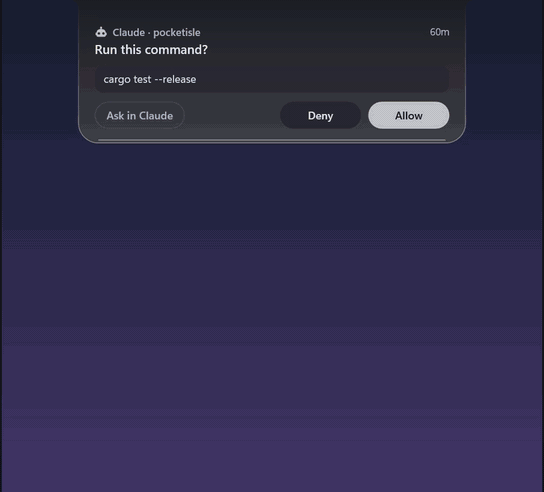
</p>

<p align="center">
  <b><a href="https://github.com/BharathwajM/pocketisle/raw/main/docs/media/tour.mp4">▶ Download the full tour video (MP4, 3 min 23 s, 2.4 MB, no narration)</a></b><br>
  <sub>Every picture and the video come from <code>pocketisle.exe demo</code>, which plays the tour by itself with made-up data.</sub>
</p>

- [The pill](#the-pill)
- [Peeks and pop-ups](#peeks-and-pop-ups)
- [Side panels](#side-panels)
- [Claude Code and Codex](#claude-code-and-codex)
- [The tabs](#the-tabs)
- [Pokémon on the island](#pokémon-on-the-island)
- [Install and build](#install-and-build)
- [Demo mode](#demo-mode)
- [Feature reference](#feature-reference) (everything, in detail)
- [Settings](#settings)
- [Claude Code hooks](#claude-code-hooks) · [Codex hooks](#codex-hooks)
- [Credits](#credits)

## The pill

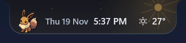&nbsp;&nbsp;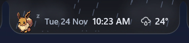

When nothing is going on, the island is a small pill with your Pokémon buddy, the date, the
time and the temperature. **The real weather plays across it**: rain slants and splashes on
its lip, storms flash, the sun's rays turn slowly, clear nights get stars and tonight's moon
phase, and fog, snow, hail, wind, heat and frost each have a look of their own.

The surface is tinted by what's going on (the accent when something needs you). While music
plays it keeps its dark colour and an "aurora" in the album art's colours lights the bottom
edge in time with the music. Hover to open it, double-click to play or pause, middle-click to mute,
scroll to change the volume, and swipe sideways to skip a song.

## Peeks and pop-ups

The island briefly grows into a card for things worth a glance, then slips back.

| | |
|---|---|
| 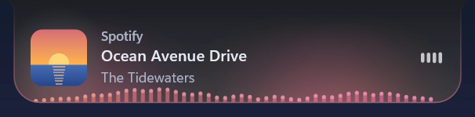<br>**A new song**: album art, title and artist, and a live equaliser in the art's colour. | 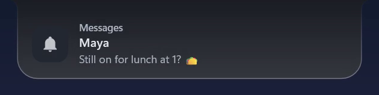<br>**Windows notifications** as short cards with the app's icon. |
| 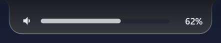<br>**Volume and brightness** replace the Windows flyout. | 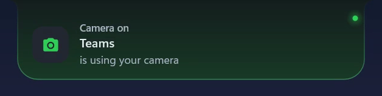<br>**Camera and microphone**: a green or orange dot, and which app turned it on. |
| 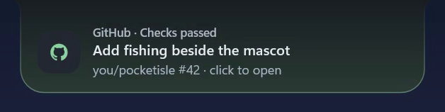<br>**GitHub**: your pull requests' checks and reviews (through the GitHub CLI). | 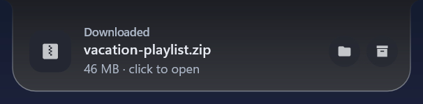<br>**Downloads**: open the file, show it in its folder, or keep it on the Shelf. |
| 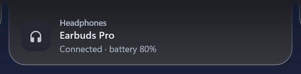<br>**Headphones** connecting, with their battery. | 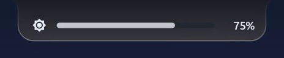<br>Also: copies, screenshots, the charger, Wi-Fi and VPN changes, heat, calendar reminders, eye breaks and a morning greeting. |

## Side panels

Small panels can sit along the top of the screen beside the island, each showing one thing
at a glance:

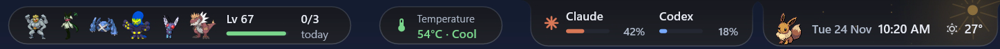<br>
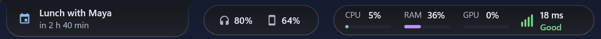

| Where | Shows |
|---|---|
| **Left wing** | Your Claude and Codex limits, or the song while music plays |
| **Right wing** | Your next calendar event |
| **Left corner** | Your Pokémon team (animated), your level and today's challenges |
| **Right corner** | CPU, memory, GPU and ping |
| **Between, left** | How hot the PC is running |
| **Between, right** | Your Bluetooth devices and their batteries |

Rest the pointer on a panel (or click it) and it grows into a small island of its own with
what the matching tab shows: the Usage, Calendar, Music, Pokédex or System tab, a temperature
dashboard, or each Bluetooth device with its battery. It closes when you move away or click it
again. The Bluetooth panel asks a device connected over Bluetooth LE (an iPhone, for one) for
its battery directly, because Windows' own copy can be hours old.

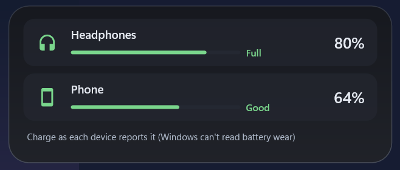

The panels hide while the island is open or asking you something, and the island leaves
out the tabs they already show. Pick which ones you want with `side_panels` in the
[settings](#settings): `"wings"` (beside the pill), `"corners"` (the far edges), `"both"` (all
six) or `"off"`.

## Claude Code and Codex

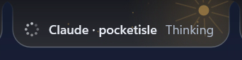&nbsp;&nbsp;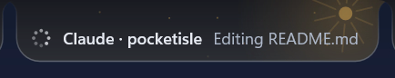

With `agent_status_in_pill` on, the pill shows what each Claude Code or Codex session is
doing right now ("Thinking", "Editing README.md", "Running cargo build").

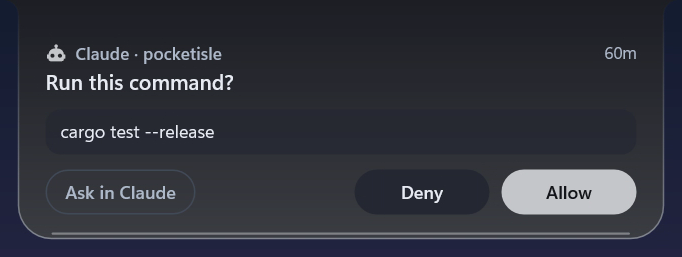

**Answer permission prompts without switching windows.** When an agent wants to run a
command, edit a file or use a tool while you're in another app, the island shows what it
wants with **Allow**, **Deny** and **Ask in Claude**. Claude's questions and plans come up the
same way, one button per option. If you don't answer, the agent asks in its own window as
usual.

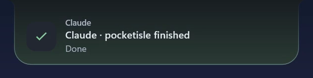

A card says when a session finishes or needs you. The **Usage** tab tracks Claude's and
Codex's plan limits (below).

## The tabs

Hover over the island and it opens. The tabs along the top are styled like YASB's round
buttons; the selected one widens to show its name, and a dot marks a tab with something
going on. There are twelve: **Music**, **Usage**, **Calendar**, **System**, **Weather**,
**Shelf**, **Pokédex**, **Battle** and **Games**, then **Home**, **Controls** and **Power** at
the right. The Pokédex and Battle tabs are under [Pokémon on the island](#pokémon-on-the-island).

A tab a [side panel](#side-panels) already shows leaves the island and opens from its panel
instead: with the default `"wings"`, that's Music, Usage (when you track Claude or Codex)
and Calendar; with `"both"`, Pokédex and System as well. The pictures here show the island
with `side_panels` set to `"off"`, so every tab is in the bar.

| | |
|---|---|
| 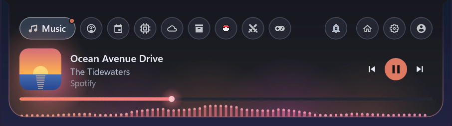<br>**Music**: art, title, artist and app, previous / play-pause / next, and a progress bar you can scrub. | 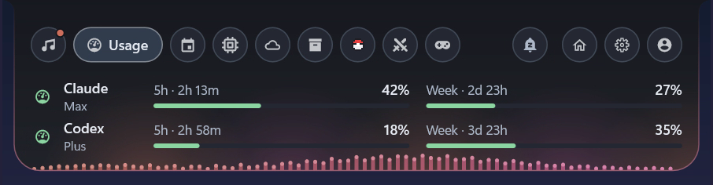<br>**Usage**: Claude's and Codex's 5-hour and weekly limits, with reset countdowns. Cards warn when one gets critical. |
| 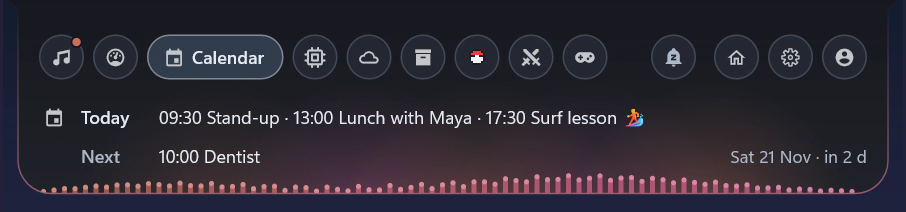<br>**Calendar**: today's events and the next one, from YASB's calendar, with reminders. | 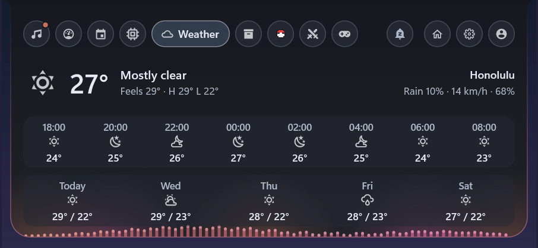<br>**Weather**: now, the next hours and the next days (Open-Meteo). |
| 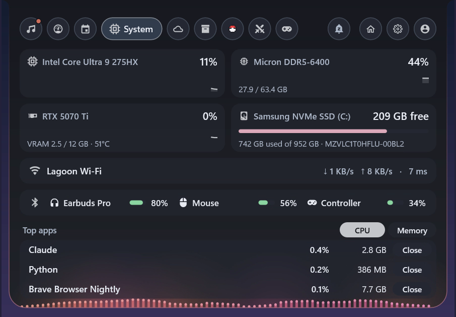<br>**System**: CPU, memory, GPU and disk with live graphs, network and ping, Bluetooth batteries, and the top apps (close one from here). Click a box for a detail page. | 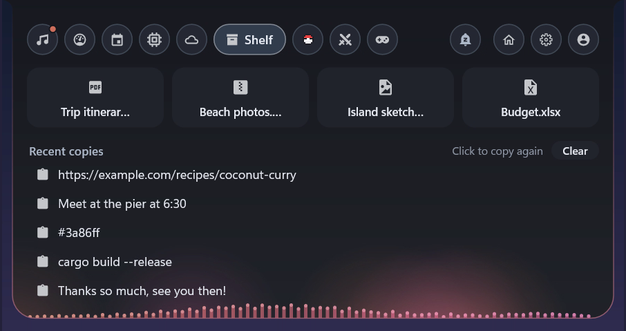<br>**Shelf**: drop files on the island to keep them handy, then drag them out again. Below, the last 20 things you copied; click one to copy it again. |
| 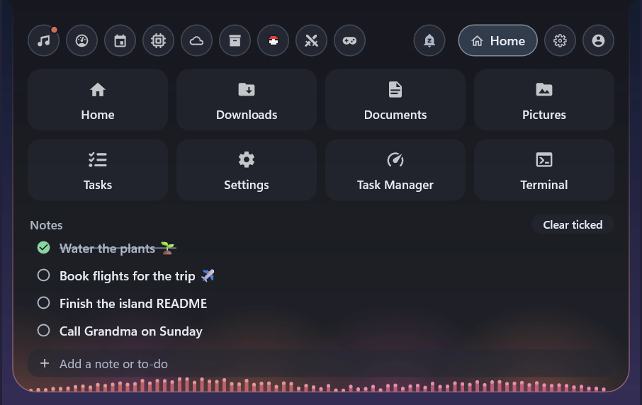<br>**Home**: shortcuts, plus notes and to-dos you can type straight into the island. | 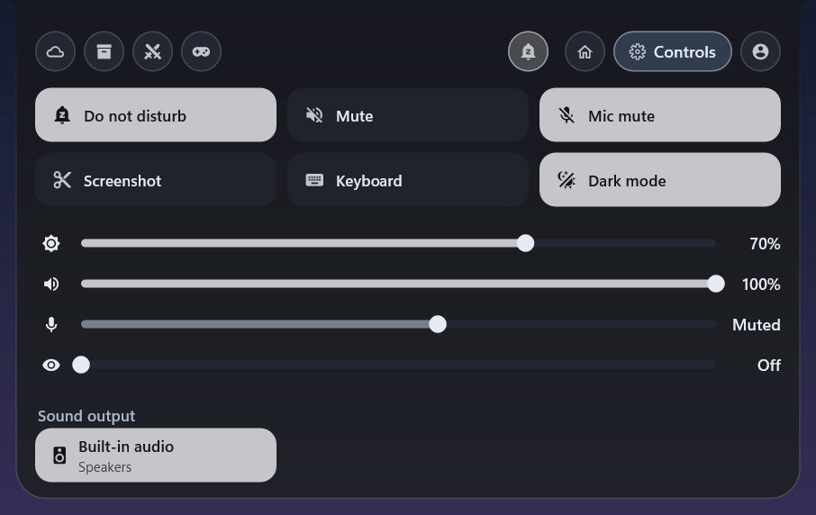<br>**Controls**: Do Not Disturb, mute, mic mute, screenshot, the touch keyboard, dark mode, brightness / volume / mic sliders, a break reminder, the sound output, and Wallpaper Engine's wallpaper of the day. |
| 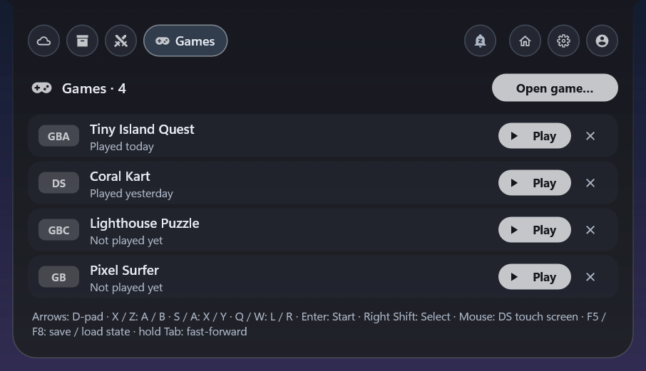<br>**Games**: play DS, GBA and Game Boy games you own, in a window of their own (melonDS and mGBA cores), with your last five listed. No games come with Pocket Isle. | 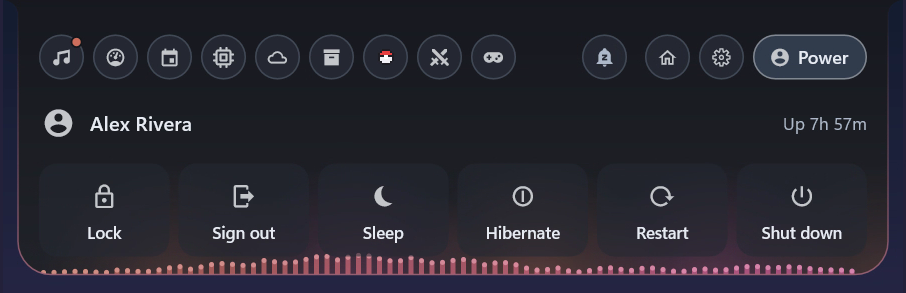<br>**Power**: lock, sign out, sleep, hibernate, restart and shut down, with your uptime. |

## Pokémon on the island

The mascot is a Pokémon that fits the weather outside (or the colour of the album art, or
your buddy). It reacts to you: pet it and hearts float up, click it and it hops and cries,
and it dozes off when you're away. Finished agent tasks, answered prompts, eye breaks and
catches give the team XP, and Pokémon evolve as the team levels up.

| | |
|---|---|
| 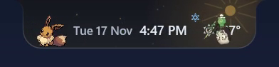<br>**Wild Pokémon** wander onto the pill every 5–15 minutes. Who comes depends on the real weather, the time of day and the season: water types in the rain, ghosts at night, no fire types in a storm. | 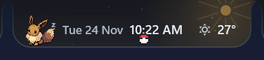<br>**Catch them** by clicking when the ring is small (*Nice!*, *Great!*, *Excellent!*). Some want to battle first: a real turn-based battle on the Battle tab, which also has a Pokémon League for every region. |
| 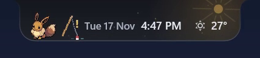<br>**Fishing**: cast a line beside your Pokémon and click the bobber when the **!** shows. Some Pokémon only bite. | 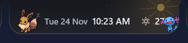<br>…then catch what you reeled in like any visitor. |
| 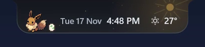<br>**Eggs** turn up now and then and hatch after a couple of hours at your PC. | 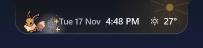<br>Babies and egg-only Pokémon hatch from them. |

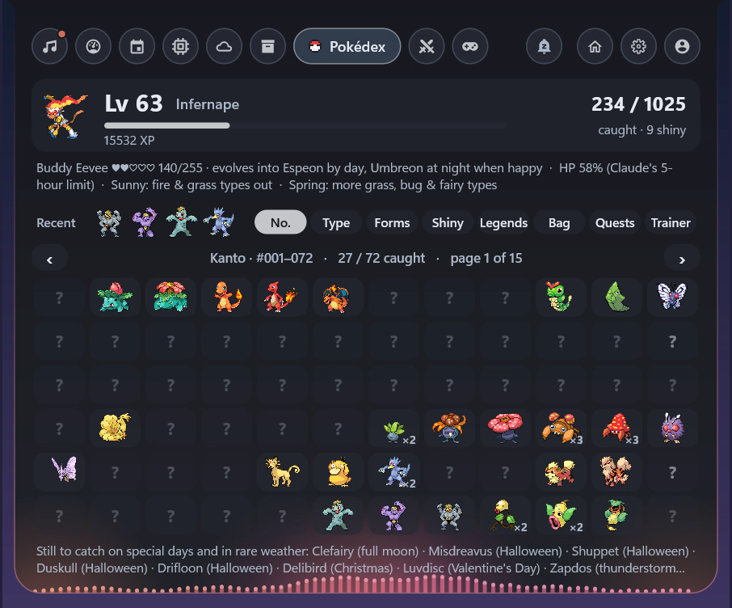

**The Pokédex tab**: the team's level, XP and next evolution, what the weather and season bring
out, recent catches, and the full **National Pokédex** (all 1025, plus 190 regional forms,
Megas and Gigantamax forms, and a Shiny Pokédex), sorted by number or type.

| | |
|---|---|
| 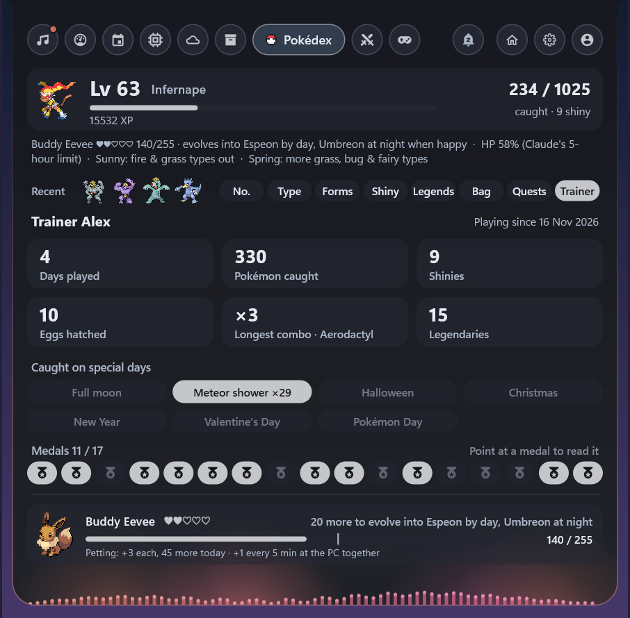<br>**Trainer card**: days played, catches, shinies, eggs, your best combo, special days and 17 medals. At the bottom, your **buddy** and its friendship: petting and time together raise it, and some Pokémon only evolve when happy (Eevee becomes Espeon by day, Umbreon at night). | 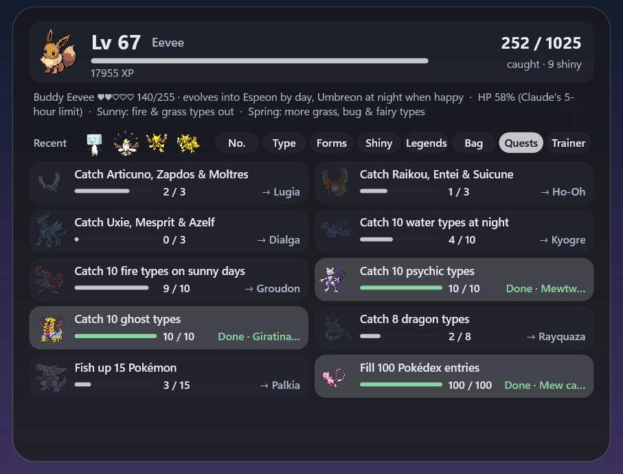<br>**Legend quests**: ten quests that each bring a legendary, like catching the three birds for Lugia or fishing up 15 for Palkia. |
| 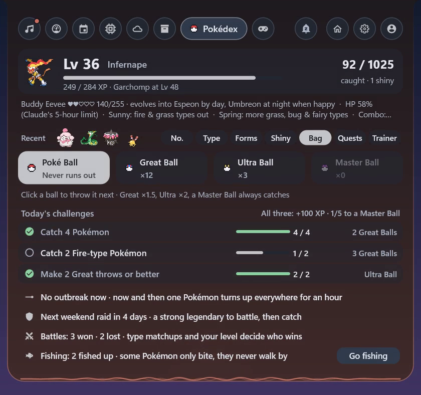<br>**Bag**: Poké, Great, Ultra and Master Balls, three daily challenges, mass outbreaks, weekend raids and battles. | Also: catch combos that raise shiny odds, special days (Halloween ghosts, full-moon Clefairy, meteor-shower Jirachi, Christmas lights), rare weather legends, and Claude's 5-hour limit as your Pokémon's HP. |

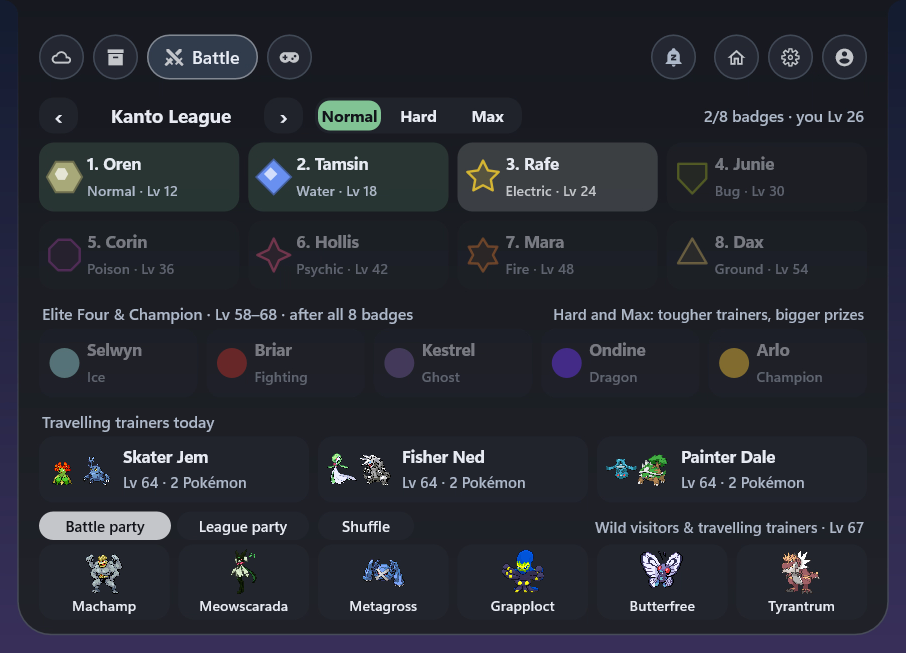

**The Battle tab**: a Pokémon League for every region (eight gyms with their badges, the Elite
Four and a champion), travelling trainers each day, and your two parties. Switch between
**Normal, Hard and Max**: tougher trainers, bigger prizes. Point at a gym to see the team it
will send out.

| | |
|---|---|
| 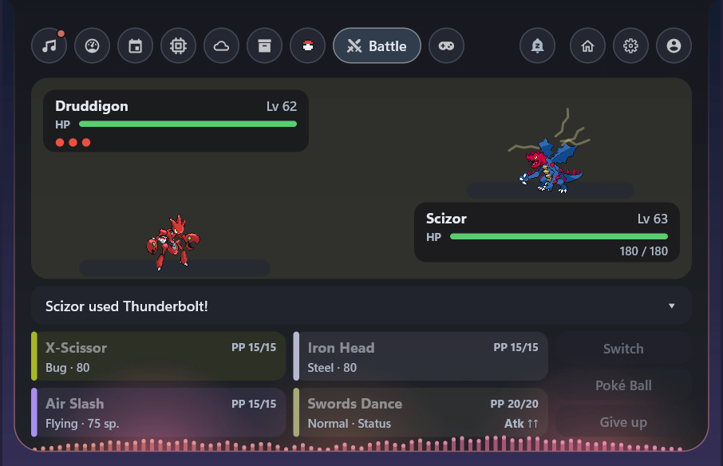<br>**Real turn-based battles** with animations for every move type: lightning, flames, water, leaves and more. | 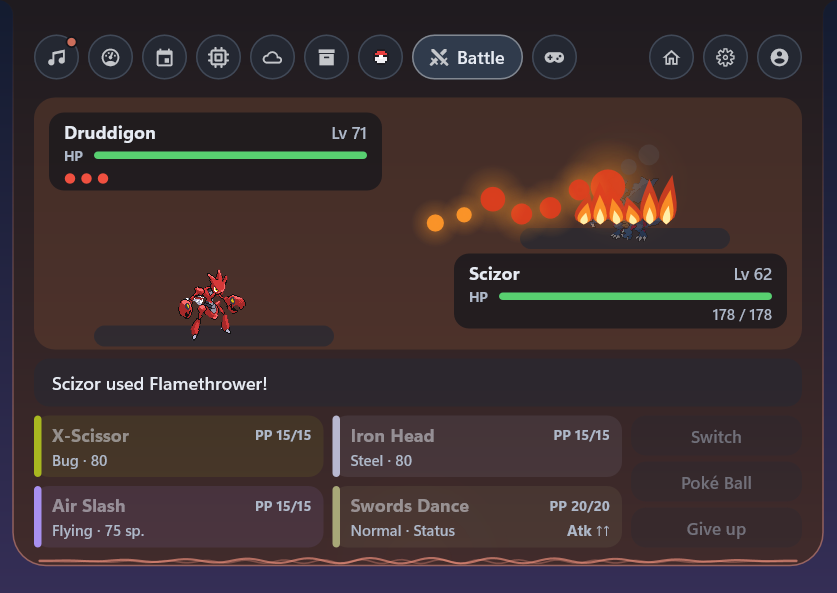<br>Type matchups, critical hits and accuracy work like the games. Pokémon battle at the evolution stage that fits their level. |
| 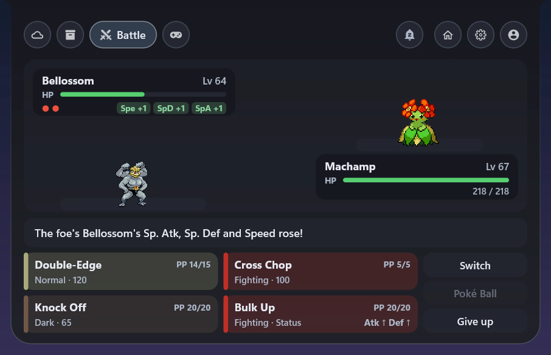<br>**PP and stat changes**: each move shows its PP, and moves like Hone Claws or Swords Dance raise stats (arrows and chips show it). | Every win gives XP and Poké Balls, more on Hard and Max (up to 2 Master Balls for beating a champion on Max). Lose to the Elite Four and the run starts over. |

Pocket Isle does not include any Pokémon sprites or cries. `tools/national_sprites.py` downloads
them for your own use (see [Credits](#credits)); without them, small hand-drawn pixel
Pokémon stand in.

## Install and build

Pocket Isle runs on 64-bit Windows 11 (it's built and tested there). It's a single `pocketisle.exe`
with nothing else to install; settings are created on first run in
`%USERPROFILE%\.config\pocketisle\config.json`.

### First: the icon font

Pocket Isle's icons come from the **JetBrainsMono Nerd Font** (YASB users already have it).
Without it the icons show as empty boxes. Install it with
`winget install DEVCOM.JetBrainsMonoNerdFont`, or download *JetBrainsMono* from
[nerdfonts.com](https://www.nerdfonts.com/font-downloads) and install the
`JetBrainsMonoNerdFontPropo-*.ttf` files.

### Option A: download a ready-built exe

1. From the [latest release](https://github.com/BharathwajM/pocketisle/releases/latest),
   download [`pocketisle.exe`](https://github.com/BharathwajM/pocketisle/releases/latest/download/pocketisle.exe)
   and [`install.ps1`](https://github.com/BharathwajM/pocketisle/releases/latest/download/install.ps1)
   into the same folder.
2. Open PowerShell in that folder and run:

   ```powershell
   powershell -ExecutionPolicy Bypass -File .\install.ps1 -Exe .\pocketisle.exe
   ```

   It installs Pocket Isle, makes it start when you sign in, and starts it. Windows SmartScreen
   may warn about a new, unsigned app the first time; choose *More info → Run anyway*.

Every push is also built and tested on GitHub: the newest build is under
[Actions → Build](https://github.com/BharathwajM/pocketisle/actions/workflows/build.yml) →
*Artifacts* (GitHub sign-in needed, kept for 90 days).

### Option B: build it yourself

1. **Install the tools** (once). In PowerShell:

   ```powershell
   winget install Git.Git
   winget install Rustlang.Rustup
   winget install Microsoft.VisualStudio.2022.BuildTools --override "--quiet --wait --add Microsoft.VisualStudio.Workload.VCTools --includeRecommended"
   ```

   Then open a **new** terminal so `git` and `cargo` are on the path. The Build Tools give
   Rust the Microsoft C++ linker and the Windows SDK it needs.

2. **Get the code:**

   ```powershell
   git clone https://github.com/BharathwajM/pocketisle.git
   cd pocketisle
   ```

3. **Build and install:**

   ```powershell
   powershell -ExecutionPolicy Bypass -File .\install.ps1
   ```

   This builds a release exe (the first build takes a few minutes), copies it to
   `%LOCALAPPDATA%\PocketIsle\pocketisle.exe`, makes it start when you sign in (a scheduled task
   called *Pocket Isle*, just for you, no admin needed) and starts it. Add `-NoStartup` to
   leave it out of start-up. Run the same command again after `git pull` to update.

   To build without installing, run `cargo build --release`; the exe is at
   `target\release\pocketisle.exe`. If `link.exe` fails because the folder's path is too long,
   build somewhere short: `$env:CARGO_TARGET_DIR = "C:\pocketisle-build"` (`install.ps1` already
   does this for you).

### What you see

The island appears at the top of your main screen (on every screen if you have more than
one). Hover to open it; right-click for the menu (settings, log, *Go fishing*, *Look for wild
Pokémon* and more). Try `pocketisle.exe demo` (see [Demo mode](#demo-mode)) for a tour.

### Optional extras

- **Pokémon sprites and cries.** Not included (see [Credits](#credits)). With Python and
  Pillow (`pip install pillow`), download them for your own use, about 118 MB, into
  `%USERPROFILE%\.config\pocketisle\sprites`:

  ```powershell
  python tools\national_sprites.py
  python tools\forms_sprites.py
  ```

  Without them, small hand-drawn pixel Pokémon stand in.
- **Claude Code and Codex** status and prompts on the island: add the
  [Claude Code hooks](#claude-code-hooks) and [Codex hooks](#codex-hooks).
- **GitHub peeks** for your pull requests: install the GitHub CLI and run `gh auth login`.
- **YASB.** Pocket Isle reads your [YASB](https://github.com/amnweb/yasb) theme, weather place and
  calendar if you have it; without YASB it uses its own dark theme and you set
  `weather_location` in the settings.
- **Games:** put the melonDS DS and mGBA libretro cores in `%LOCALAPPDATA%\PocketIsle\cores`,
  then *Open game…* on the Games tab with games you own.

### Uninstall

```powershell
powershell -ExecutionPolicy Bypass -File .\uninstall.ps1
```

This closes Pocket Isle, stops it starting with Windows and removes the program. Your settings,
Pokédex, notes, sprites and game saves are kept; add `-RemoveSettings` to delete those too.
If you added Claude Code or Codex hooks, take them out of their settings files.

## Demo mode

```
pocketisle.exe demo
```

This plays a ~3-minute tour of every feature by itself, using made-up music, weather, usage,
calendar events, notes, files, notifications and Claude prompts, in front of a plain backdrop.
It reads none of your data and ignores the mouse and keyboard. Its settings and saves go to
`%LOCALAPPDATA%\PocketIsle\demo`, a fresh copy of your settings and Pokédex each run, so your real
files are never touched. Close your normal island first; the demo quits when the tour ends.
The pictures and the video above were recorded from it with ffmpeg.

## Feature reference

- **Side panels.** See [Side panels](#side-panels). The team shows each Pokémon at the stage
  that fits your level, as the Battle tab does. A panel opens 250 ms after the pointer comes
  to rest on it; it is drawn once, unseen, while you wait, so it opens without a stutter.
- **Back after a crash.** The copy of Pocket Isle that starts with Windows only keeps watch:
  it runs the island as a second copy of itself and starts it again two seconds after a crash
  (not when you quit it or end it in Task Manager). After four crashes in ten minutes it
  stops trying, and the log says why. Ending the watcher ends the island too.
- **Volume & brightness pop-up.** Takes over the volume keys, so the Windows flyout never
  shows. Scroll on the island to change volume too.
- **Now playing.** Album art, title, artist and source app; hover (or click) for
  previous / play-pause / next and a progress bar. The equaliser and play button take the
  colour of the artwork. Pause and, after a second and a half, the pill goes back to the
  date and time (hover still opens the player).
- **Every screen.** With a laptop and a monitor, each screen gets an island of its own at
  the top. They are separate: hovering or opening one leaves the other closed, and each
  keeps its own tab. What they show is shared: the same music, agents, questions, cards
  and clock. Answer a question on either one and it's answered. Full-screen apps hide only
  the main screen's island. `all_monitors: false` keeps it on the main screen only.
- **Claude Code and Codex status.** What each session is doing right now ("Running cargo build",
  "Editing app.rs") in the pill when `agent_status_in_pill` is on, plus a needs-you card (stays until you answer;
  click to jump to the Claude / Codex app or Windows Terminal). By default agents work
  quietly: the pill keeps showing weather and usage, and the island only speaks up when they
  need you. Set `agent_status_in_pill` to `true` to also show live activity in the pill and a
  card with the agent's last message when it finishes.
- **Answer permission prompts on the island.** When Claude Code or Codex wants to run a
  command, edit a file or use a tool and you're in another app, the island shows what it
  wants with **Allow**, **Deny** and **Ask in Claude / Codex**. If you don't answer within 90
  seconds (or Pocket Isle isn't running), the agent asks in its own window as usual. While the
  Claude app, the Codex app or Windows Terminal is in front, it asks there instead (unless
  `decisions_when_claude_focused` is on).
- **Answer Claude's questions and plans on the island.** When Claude Code asks you something
  (AskUserQuestion) each question becomes a card with one button per option; when it
  finishes a plan you get **Approve plan** / **Keep planning**. **Open chat instead** (or no
  answer within `decision_timeout_seconds`) leaves it to Claude's own window. Pick-several
  questions get a check box on each option and a **Done** button. Typing your own answer
  ("Other") still happens in Claude's window. Codex's questions use `pocketisle.exe ask` (below).
- **AI plan limits** (what Codenotch did). Claude's 5-hour and weekly usage and Codex's
  5-hour and weekly rate limits: two rings in the pill when it's otherwise idle (outer =
  5-hour, inner = week), a bar per limit with reset countdowns when expanded, and a card
  when a limit gets critical, runs out, or resets after being high. Green below 50%, gold
  from 50%, red from 70%.
- **Notifications.** Windows toasts appear as a short card with the app's icon.
- **Codes from SMS and email.** When a notification holds a one-time code ("Your verification
  code is 482913", "G-482913", "123 456", or letters and digits like "code: K7P2QX"), the card
  shows the code large with a copy button and stays
  30 s, ahead of other cards. Click it and the code is copied, marked so Windows clipboard history
  and the cloud clipboard don't keep it. Card endings, amounts, phone numbers, dates and times
  aren't mistaken for codes, and codes are never written to the log. To get your phone's codes,
  pair it with **Phone Link** (built into Windows; Android over Wi-Fi with Link to Windows,
  iPhone over Bluetooth) and leave its notifications on: Phone Link shows them as Windows
  notifications, which the island reads like any other. Email codes come the same way from any
  mail app that shows Windows notifications (Outlook, or Gmail in Chrome or Edge with desktop
  notifications on), or from your phone's mail app through Phone Link. Discount codes
  ("use code SAVE20") are left alone. Keep the Phone Link window closed or minimised: while
  it's open, Phone Link shows phone notifications only in its own window, not as Windows
  notifications (it keeps running in the background when closed).
- **Okta Verify sign-in requests** show as a "Sign-in request" card so you know to pick up your
  phone. Approving stays on the phone, where Okta checks it really is you. For sign-in with no
  phone at all, Okta Verify for Windows with FastPass uses Windows Hello, if your company has it on.
- **Microphone and camera.** A green dot on the island while an app uses the camera, an
  orange one for the microphone (like the phone's), and a peek naming the app when it
  starts. Read from the same place as Windows' own privacy indicator (no permission
  needed); a desktop app that crashed mid-call is only counted while it's running.
- **Network and VPN.** A peek when Wi-Fi drops or comes back, when you switch networks,
  and when a VPN connects or disconnects (WireGuard, OpenVPN, Tailscale, WARP, built-in
  Windows VPNs and most others). A blip shorter than 4 seconds isn't reported. The System
  tab shows the network, download / upload speed and ping (to 1.1.1.1).
- **Screen-time breaks.** After an hour of steady use (`break_minutes`), a 20-20-20 card:
  look at something 6 m away for 20 seconds, with a countdown. Not during a call (the
  microphone is on) or anything full screen; three minutes away from the computer starts
  the hour again. For a one-off reminder, drag the **Break in** slider on the Controls tab
  (5 minutes to 2 hours): the same card comes up when it's time.
- **Morning greeting.** The first time you're at the computer each day (from 5 am, so after
  unlocking or waking it in the morning), a card says good morning (or afternoon, or
  evening) with your first name, the weather and the day's high, how many events you have
  and the next one, and any special day or what tonight might bring ("Meteor shower
  tonight if it's clear", "Full moon tonight"). `morning_greeting`
- **Shelf.** Drag files onto the island: it opens on the **Shelf** tab and keeps them
  there (across restarts, up to 12). Drag one out into Explorer, an email or a chat, click
  to open it, or hover and click × to remove it. Below, **Recent copies** lists the last
  20 things copied, six a page (text and pictures, never private ones such as what a
  password manager copies); click one to put it back on the clipboard, × to drop one,
  **Clear** for all. The text is kept in `~/.config/pocketisle/clips.json` so it's still there
  after a restart; pictures (the five newest) stay in memory only. `clipboard_history`
- **Quick actions on the pill.** Double-click: play / pause. Middle-click: mute (with the
  volume pop-up). Right-click and drag sideways: scrub the song (300 px = the whole track),
  with the time shown as you drag; a plain right-click still opens the menu.
- **Clock.** Day, date and time ("Sun 15 Nov 1:14 PM") at the start of the pill, in 12- or
  24-hour time to match Windows' short-time setting; updates on the minute.
- **Calendar.** Today's events and the next upcoming one from YASB's clock calendar
  (`calendar-events.json`), plus a reminder before timed events.

- **System.** CPU, memory, GPU (utilisation, VRAM, temperature, via the NVIDIA driver's
  NVML) and C: drive, with live graphs, and **Top apps**: the three programs using the
  most CPU or memory (switch with the CPU / Memory buttons; a program's processes count
  together, named as the program calls itself). **Close** asks *Sure?*; a second click
  asks its windows to close so it can save first, and ends it only if it has no windows.
  Windows itself and the island are never listed. Under the network row, the battery of
  each connected Bluetooth device Windows knows one for (earbuds, mouse, keyboard,
  controller, phone), as Windows last read it, red at 20% or less. Only measured while the
  tab is open.
- **Bluetooth panel.** The side panel between the next event and the PC panel lists every
  connected Bluetooth device. Windows' own copy of a device's battery can be hours old, so a
  device connected over Bluetooth LE (an iPhone, for one) is asked for its battery directly,
  at most once a minute and again when you open the panel; if it doesn't answer within 6
  seconds, Windows' number is shown.
- **Weather.** Open-Meteo for the place set in YASB's weather widget: now, the next six
  hours and the next six days. The temperature also shows in the idle pill.
- **Home.** Shortcut buttons (Home, Downloads, Documents, Pictures, This PC, Settings, Task
  Manager, Terminal);
  edit `shortcuts` in the settings. Below them, **Notes**: click the box and type a note or
  to-do (Enter adds it, Esc stops; Ctrl+V pastes), click one to tick it, × to remove it,
  **Clear ticked** to tidy up. Up to eight, kept in `~/.config/pocketisle/notes.json`. The
  island stays open while you type.
- **Controls.** Do Not Disturb, mute, mic mute, screenshot, touch keyboard, dark mode, and
  brightness / volume / microphone sliders (drag or click), and **Break in** (see
  Screen-time breaks). **Do Not Disturb** also pauses wild Pokémon, eggs turning up and
  the island keeper's announcements until you turn it off. **Sound output** lists the
  outputs that are plugged in (speakers, headphones, a monitor's speakers); the lit one is
  the default and clicking another switches to it, the same as the Windows sound menu
  (Steam's streaming outputs are left out).
- **Power.** Lock, sign out, sleep, hibernate, restart, shut down (sign out and the last
  three ask for a second click), with your name and uptime.

Hover or click the island to open it. Along the top are tabs styled like YASB's round
widget buttons: **Music**, **Usage**, **Calendar**, **System**, **Weather**, **Shelf**,
**Pokédex**, **Battle**, **Games**, and on the right **Home**, **Controls** and **Power**
(tabs a side panel shows open from the panel instead). The selected tab widens to show its name, and a
small dot marks a tab with something going on (music playing, a limit in the red). The
island opens on the tab you last used. Claude's and Codex's questions and permission
prompts come up on their own as cards, so there's no Agents tab.

These can replace YASB's home, systeminfo-grouper, gold_tasks, weather, hardware-grouper,
control_center and power_menu widgets (comment them out in YASB's `config.yaml`).

It reads your YASB theme (`styles.css`, `yasb_colors.css`, `config.yaml`): colours, fonts,
corner rounding and bar height/padding, so it looks like part of the bar.
The accent colour (selected tab, play button, Allow button, rings) comes from your desktop
wallpaper's strongest colour, toned to read well on the dark pill. A black-and-white
wallpaper gives a soft silver. It follows wallpaper changes by itself and re-checks when the
island opens; the gold "watch" level on the usage rings keeps YASB's own accent.
Set `accent_from_wallpaper` to `false` to use YASB's accent everywhere.
While Wallpaper Engine is running, the accent comes from the preview picture of the wallpaper
on your first screen instead.

**Wallpaper of the day (Wallpaper Engine).** If you have Wallpaper Engine from Steam, every
morning (from 6 am) each screen gets a different wallpaper from your own Wallpaper Engine
library, through its command line. Only scenes, videos and web wallpapers rated Everyone are
used, and none of the last 60 shown comes back soon. Nothing is downloaded. The first day it
only remembers the date, so the first change is the next morning. The Controls tab shows
what's on and has an **Another** button for a fresh one now. A small card says what it picked
(never right at start-up). `daily_wallpaper`
Right-click the island → *Reload YASB theme & settings* after changing your theme.

### Look and feel ("Lagoon")

- **Hangs from the top edge.** The island is joined to the top of the screen, with small
  curved shoulders where it meets the edge, so it reads as part of the display rather than
  a floating pill. Set `attach_to_top` to `false` for the old floating pill.
- **Mood colour.** The surface is a soft vertical gradient tinted by what's going on: the
  accent for questions, approvals and Claude waiting, the artwork's colour while music
  plays, a muted accent while an agent works. Colours fade into each other rather than
  switching.
- **Aurora.** While music plays, the album art's colour and a partner colour (its hue
  turned a little: orange with pink, blue with cyan) light the island's lower lip: soft
  lights drift to and fro and a thin spectrum rises and falls with the actual output level,
  a swell travelling across it. The progress bar runs through the same two colours to a
  glowing head, and a halo glows behind the album art (the equaliser follows them too).
- **Touch.** Hovering swells the pill slightly and lights the surface under the cursor;
  clicking sends a ripple out from where you clicked.
- **Pip.** A tiny pixel palm island in the pill that reacts: fronds sway (more with music),
  it hops when a new song starts or an agent needs you, shows a **!** while you're needed,
  a **♪** with music and drifting **z**s late at night. Set `mascot` to `false` to hide it.
- **Pokémon.** By default the mascot is a Pokémon instead of Pip. When the pill is idle
  or needs you, **a Pokémon that fits the weather outside** looks after the island, picked
  at random from those that suit it and kept until the weather changes (or for three
  hours), with a card and its cry when a new one arrives:
  rain Kyogre, Blastoise, Gyarados, Feraligatr, Empoleon, Samurott, Swampert, Suicune;
  heavy rain Kyogre, Palkia, Gyarados, Blastoise, Kingdra, Feraligatr; drizzle Suicune,
  Vaporeon, Milotic, Lapras, Azumarill, Ludicolo, Swampert; thunderstorm Zapdos, Raikou,
  Zekrom, Thundurus, Ampharos, Luxray, Electivire, Raichu, Jolteon, Pikachu; hail
  Articuno, Kyurem, Regice, Mamoswine, Glaceon, Walrein, Lapras; snow Articuno, Glaceon,
  Regice, Abomasnow, Froslass, Weavile, Lapras; fog Mewtwo, Giratina, Gengar, Gardevoir,
  Mismagius, Darkrai; wind (25 km/h+) Rayquaza, Lugia, Tornadus, Pidgeot, Staraptor,
  Salamence, Dragonite, Braviary; heat (28°+) Groudon, Entei, Heatran, Reshiram, Charizard,
  Arcanine, Magmortar, Typhlosion; cold (10° or less) Articuno, Glaceon, Lapras, Walrein,
  Abomasnow, Weavile; clear nights Darkrai, Umbreon, Cresselia, Gengar, Absol, Houndoom,
  Mismagius; sunshine Groudon, Charizard, Victini, Reshiram, Entei, Arcanine, Ninetales,
  Typhlosion, Infernape; clouds Rayquaza, Lugia, Latias, Latios, Altaria, Dragonite,
  Togekiss. Only downloaded ones are picked (`tools\national_sprites.py` gets them all);
  with none, Rayquaza stays. From team level 50 it's shiny when there's a shiny sprite.
  On a special day or night (below) its keepers come first: Gengar, Chandelure or Giratina
  for Halloween, Clefable or Cresselia under a full moon, Jirachi or Deoxys in a meteor
  shower, Delibird or Glaceon at Christmas.
  While music plays,
  the album art's colour picks one: yellow Pikachu, green Sceptile, blue Swampert, red
  Infernape, purple Garchomp, white / silver Arceus, orange Charizard, cyan Lapras, pink
  Mew, black Umbreon, brown Eevee. Set `mascot_pokemon` to `false` for Pip.
  - **Real animated sprites.** `tools\national_sprites.py` downloads the animated
    Black/White game sprites from the PokeAPI sprites repository into
    `~/.config/pocketisle/sprites` (a PNG strip of frames plus a JSON file of frame timings per
    Pokémon). They play non-stop at the game's own frame timings: the island wakes exactly
    when the next frame is due, using a precise timer. Each sprite is shrunk to its
    on-screen size once, when it loads, so a frame costs only a pixel copy, and only the
    mascot's corner of the pill is redrawn (about 2% of one core). These are Nintendo /
    Game Freak art, fine on your own PC, but don't redistribute them.
  - **Without the download**, small hand-drawn pixel versions stand in. They breathe,
    blink, flicker their flames and bounce to the beat.
  - **Pet and poke.** Rest the pointer on the Pokémon and hearts float up (it won't open the
    island while you're petting it). Click it and it hops and plays its cry. It turns to
    look at the pointer, and dozes off (slow, with **z**s) after 5 minutes without input.
  - **XP and evolving.** The team earns XP: a finished Claude / Codex task +20, an answered
    prompt +8, an eye break +10, a catch +30 (legendary +100, shiny +150), petting +3 and
    poking +1 now and then. A little **+XP** pops above it. Level L needs 4·(L−1)² XP
    (Lv 16 at 900). Everyone starts at their first stage and evolves with the team: Pichu →
    Pikachu (Lv 12), Treecko → Grovyle → Sceptile, Mudkip → Marshtomp → Swampert,
    Charmander → Charmeleon → Charizard (Lv 16 / 36), Chimchar → Monferno (14) → Infernape
    (36), Gible → Gabite (24) → Garchomp (48), Eevee → Umbreon (25). Rayquaza, Lapras, Mew,
    Arceus and Eevee don't evolve; they turn shiny at Lv 50. A card says who evolved, but
    only for team members you've seen on the island (the ones that show with music meet you
    already evolved); the Pokédex tab's "next evolution" works the same way.
  - **Wild Pokémon.** At a random time every 5–15 minutes (`wild_minutes`, e.g. `[5, 15]`;
    only while you're at the computer and nothing is full screen, otherwise it looks again a
    minute later) a wild Pokémon walks onto the pill and **waits there until you catch it**
    (hopping now and then so you notice it). It only leaves if it breaks out of three Poké
    Balls. One that's waiting when Pocket Isle closes is back after a restart.
    Any of the 1025 can visit: first stages most often, evolved ones less (about a third as
    often, final stages an eighth). Legendaries, mythicals, Ultra Beasts and Paradox Pokémon
    are the rare ones (1 in 30), babies only hatch from Eggs, and 1 in 64 is shiny (better
    with a combo). Only Pokémon whose sprite is downloaded come. Right-click →
    *Look for wild Pokémon* calls one now. Clicking a visitor (or near it, or while the ball
    is out) never opens the island. `wild_pokemon`
  - **Weather and time decide who visits.** The Weather tab's real weather, temperature,
    wind and the hour change who's about: drizzle makes water types (Psyduck, Wooper,
    Marill…) 2.5× as likely, rain 4×, heavy rain 6×; a thunderstorm brings electric types
    (5×) and water types; hail electric, icy and water types; sun fire and grass types
    (and fewer water types); fog ghosts and drifters; cloudy skies fairy, fighting and
    poison types; snow Piplup, Swablu and Snorlax.
    **Fire types never come out in any rain, storm or hail**, and are rarer in snow and
    cold. Heat (28°+) brings more fire types, cold (10° or less) icy ones, wind (25 km/h+)
    flying ones (Pidgey, Swablu, Jigglypuff, Lugia), and night ghost and dark types
    (Gastly, Zorua, Litwick…) with fewer grass types. Kyogre likes rain, Groudon sun,
    Darkrai the night. It all goes by type, so every water type likes the rain and so on.
    The lines are set for a mild climate like Sydney's, where it never snows and 30° days
    are rare, so the heat, the cold and the wind all still come round each year, and a
    partly cloudy sky counts as sunny.
    The Pokédex tab says what's out now. A visitor the weather suits (twice as likely as
    usual or more) is **weather-boosted**: the weather's icon shows by its head, it's a
    little easier to catch, and it gives half as much XP again.
  - **Roaming legends.** The birds, the beasts and the lake trio come their own way, not from
    the everyday legendary pool. While their weather lasts, 1 visitor in 12 is one of them:
    Zapdos in a thunderstorm or the wind (25 km/h+), Raikou in a thunderstorm or a
    downpour, Suicune in any rain, Articuno in snow, hail or the cold (10° or less), and
    Moltres and Entei in the heat (28°+, dry) or on a warm sunny day (25°+). Every day,
    1 visitor in 30 is Uxie at dawn (5–8 am), Mesprit at dusk (5–8 pm) or Azelf at night.
    Legendary, so hard to catch. Moltres also looks after the island in the heat.
  - **Special days and nights.** Halloween week (25–31 Oct) sends ghosts (Gastly,
    Misdreavus, Shuppet, Duskull, Drifloon, Litwick, Zorua) half the time, with purple and
    green wisps drifting up the island. A **full moon** (worked out from the date, within a
    day of full, on a dry night) brings Clefairy and a big bright moon. A **clear night**
    within two days of a meteor shower's peak (Quadrantids 3 Jan, Lyrids 22 Apr, Eta
    Aquariids 6 May, Perseids 12 Aug, Orionids 21 Oct, Leonids 17 Nov, Geminids 14 Dec), or
    one clear night in six for luck, is a **meteor shower**: a shooting star every couple of
    seconds and a 1 in 5 chance a visitor is Jirachi or Deoxys (legendary, so hard to
    catch). Christmas (20–26 Dec) brings Delibird and fairy lights along the edge, Valentine's
    Day Luvdisc and Clefairy, Pokémon Day (27 Feb) the starters, and New Year's Eve/Day and
    Pokémon Day double the shiny odds.
  - **Catch combos.** Catch the same species again and again and its shiny odds climb, as
    chaining does in the games: 1 in 64 normally, 1 in 32 after one catch, 1 in 16 after
    three, down to 1 in 8 from seven in a row. That species turns up more often too (up to
    3×). Catching a different one starts over. The catch card shows *Combo ×N! Shiny odds 1
    in M*, and the Pokédex tab shows the current combo.
  - **Meeting heads-up.** 5 minutes before a timed event in the calendar
    (`meeting_sign_minutes`) your Pokémon holds up a little wooden sign, *Meeting in 5*,
    counting down each minute and turning red with *Meeting now!* when it starts.
  - **Timed catching.** Rest the pointer on a visitor and a ring shrinks around it, over
    and over (green, gold for a shiny, red for a legendary). Click when it's small: *Nice!*,
    *Great!* or *Excellent!* (+5 / +10 XP). A common one stays in 45–95% of the time
    depending on the throw, a legendary 5–35%. If it breaks free it stays and you can throw
    again; after three balls it runs off. `timed_catch` (off: one click, common ones always
    caught; a legendary still gets three balls)
  - **Claude limit = HP.** Your Pokémon's HP is what's left of Claude's 5-hour limit
    (shown on the Pokédex tab; no bar in the pill). At 100% used it faints:
    greyed out, lying still with **z**s, and a card says when it's back. When the limit
    resets it wakes up with a card. `claude_hp`
  - **Pokémon Eggs.** Now and then an egg turns up instead of a visitor (more likely before
    your first). It sits beside your Pokémon and wobbles, more often as it gets close.
    After `egg_minutes` (120) minutes of you using the PC it shakes, cracks, flashes and
    hatches into a baby (Pichu, Togepi, Riolu, Munchlax…) or Larvitar, Deino or Axew, Pokémon you only get from Eggs
    (1 in 32 shiny), +50 XP. `eggs`
  - **Pokédex tab.** The team's level, XP bar and next evolution, a line with the HP, what
    the weather brings out, any special day, the catch combo and the egg's time left, and
    a **Recent** row with the last ten caught or hatched. The **National Pokédex**: all
    1025, every region, 72 a page (‹ › to turn; the bar says which region and numbers, and
    how many on the page you've caught). It sorts by number or by **Type** (a coloured dot
    shows each one's type): caught ones with their sprite and count (a sparkle for shiny),
    **?** for the rest and a faint egg for the egg-only ones. Below it, the special-day and
    rare-weather Pokémon still to catch and when they come out ("Clefairy (full moon) ·
    Deoxys (meteor shower) · Zapdos (thunderstorm or wind)…").
  - **Caught Pokémon evolve with the team.** When the team's level reaches a caught
    Pokémon's evolution level, the evolved form joins your Pokédex (the one you caught
    stays in it too), so the Pokédex fills itself in as you gain XP: Pidgey → Pidgeotto at
    Lv 18 → Pidgeot at 36, Marill → Azumarill at 18. Level-up evolutions use the games'
    levels; others use a level of their own: friendship 20, stones 30, trades 36, anything
    else 30 (always at least 5 after the evolution before). With more than one way to
    evolve (Eevee, Gloom, Kirlia…), each one you caught takes the next way, so catching
    more fills in the rest. A shiny evolves into a shiny. A card says who evolved (after a
    level-up, or a catch or hatch once the team is past that level); the Pokédex tab's line
    shows the next one ("Next: Marill → Azumarill at Lv 18"). At start-up it quietly catches
    up.
  - **Forms.** The Pokédex tab's **Forms** button: 190 more on their own pages, apart from
    the 1025: regional forms (18 Alolan, 19 Galarian, 16 Hisuian, 4 Paldean), 99 Mega
    Evolutions and Primal Reversions (the Legends Z-A ones too) and 34 Gigantamax forms.
    Regional forms wander by like any other Pokémon, by the same weather rules, and evolve
    into their own forms (Alolan Vulpix → Alolan Ninetales), or into the Pokémon only
    they evolve into (Galarian Meowth → Perrserker, Paldean Wooper → Clodsire). A
    Pokémon you've caught can Mega Evolve once the team is Lv 40 (each of its Megas joins
    the Forms page, with a card). Gigantamax Pokémon are rare visitors: 1 in 50, or 1 in 10
    in a thunderstorm or strong wind. Their sprites, shinies and cries come from
    `tools\forms_sprites.py` (run after `national_sprites.py`; same rules: personal
    use).
  - **Legends.** The Pokédex tab's **Legends** button: every legendary, mythical, Ultra
    Beast and Paradox Pokémon (128, the Galarian birds included), one region a page from
    Kanto to Paldea, with ‹ › to move between them. Each shows its name; the ones still to
    catch are faint. The top line counts the region and all of them ("Kanto legends · 2 / 5
    caught · 8 / 128 in all"), and the bottom line says how the missing ones turn up: the
    weather and time-of-day roamers, special nights, and the legend quests that bring them.
  - **Poké Balls.** The Pokédex tab's **Bag** button shows your balls: Poké Balls never run
    out, **Great Balls** make a throw 1.5× as likely to hold, **Ultra Balls** 2×, and a
    **Master Ball** always catches. Click one to throw it next (you're back on Poké Balls
    when it runs out); while aiming at a visitor the picked ball shows beside it. You start
    with three Great Balls and an Ultra Ball, and earn more: a Great Ball every 5 catches in
    a row of the same species, an Ultra Ball every 10, balls from daily challenges and
    sometimes from battles, and a Master Ball for every fifth day you finish all three
    challenges.
  - **Daily challenges.** Three a day, the same all day, in the Bag: always *Catch 3–5
    Pokémon*, plus two of *Catch 2 Fire-type Pokémon* (a common type), *Catch 2 on the first
    ball*, *Make 2 Great throws or better*, *Win a battle* and, when you carry an Egg,
    *Hatch an Egg*. Each gives Great or Ultra Balls; all three give +100 XP.
  - **Mass outbreaks.** Now and then a visitor brings a crowd: for the next hour most
    visitors are that species, they come every 2–4 minutes, and its shiny odds are three
    times better. A card says when one starts, and the Pokédex tab shows how long is left.
    `outbreaks`
  - **Battles.** About one visitor in five (never a legendary or a shiny) wants to battle
    first: crossed swords show over it. Click it and the island opens on the **Battle** tab
    for a real turn-based battle, your team against it. Each Pokémon has its real base
    stats and up to four real moves it learns by levelling up (the strongest it knows at
    your team's level, preferring different types). Damage works like the games: level,
    Attack against Defense (Sp. Atk against Sp. Def for special moves), half again for a
    move of its own type, the real type chart (dual types included), critical hits and a
    little luck; the faster Pokémon moves first, and moves like Quick Attack go before
    others. Each move button shows its type and power and says if it's **Super effective**
    against the foe. Moves are animated like the games: Dragon Claw rakes glowing claw marks
    across the foe, Thunderbolt crackles at it with a flash, Flamethrower pours fire and
    leaves it burning, Crunch snaps fangs shut, Shadow Ball flies and bursts, Earthquake
    shakes the field and cracks the ground, Ice Beam freezes it in a block of ice that
    shatters; attackers lunge or power up, targets get knocked back, and the field takes on
    the move's colour. **Switch** to another team member (it uses your turn), throw a
    **Ball** (the lower its HP, the likelier it holds; a Master Ball always does) or
    **Run**. Win and it's tired, so easier to catch on the pill (+40 XP, sometimes a Great
    Ball); lose and it runs off (+10 XP). A fainted Pokémon (Claude's limit used up) can't
    battle. Each move has **PP** like the games (Flamethrower 15, Fire Blast 5…), shown on
    its button; out of PP on every move, a Pokémon Struggles (and is hurt by the recoil).
    **Stat changes** work like the games too, −6 to +6 stages: moves that only raise or
    lower stats (Swords Dance, Dragon Dance, Calm Mind, Growl, Scary Face, Double Team…)
    and attacks with a side effect (Close Combat lowers your Defense and Sp. Def, Overheat
    your Sp. Atk; Psychic has a 10% chance to lower the foe's Sp. Def, Crunch 20% its
    Defense). Raised and lowered stats show as chips in the info boxes ("Atk +2") with
    arrows over the Pokémon, and reset when it switches out. Each Pokémon knows up to three
    attacks plus its most useful stat move; trainers now and then power up first.
    Burns, paralysis and other conditions, abilities and held items aren't in (yet). `battles`
  - **Your team.** The Battle tab's bottom row: six of your catches, one per evolution
    family, chosen at random (never legendaries, Megas or Gigantamax); **Shuffle** draws a
    new six, or click a slot to choose one yourself. The picker lists everyone you've
    caught, strongest first; point at one to see its types, stats and moves at the
    party's level. This **Battle party** fights wild visitors and travelling trainers at
    your team's level. The **League party** (the toggle above the slots) is a second six
    for gyms, the Elite Four and the champion, and fights at the league's level instead:
    two above the gym leader's, or two below the champion's for the Elite Four and
    champion, so league battles stay a real challenge. Every Pokémon battles as the
    stage of its family that fits the level, using the real evolution levels: your
    Charizard is a Charmeleon at Lv 20 and a Charmander at Lv 14; a Charmander you caught
    is a Charizard at Lv 40 (Pokémon that can evolve more than one way, like Eevee, stay
    as they are; babies are never brought back). Everyone is healed after each battle
    (except between the Elite Four and the champion).
  - **Pokémon League.** The Battle tab has a league for every region, Kanto to Paldea
    (‹ › to change region), with trainers of the island's own: eight **gyms**, each with a
    type and a badge (the Cinder Badge for fire, the Tide Badge for water…), taken in order;
    then the **Elite Four** and the **champion** back to back, your team's HP and PP
    carried from one to the next. Teams come from the region's own Pokémon, of the gym's
    type, each at the evolution stage its level calls for (a Lv 20 trainer has a
    Charmeleon, never a Charizard); the champion uses the region's strongest.
    Levels rise through each region and from region to region: Kanto's first gym is Lv 12
    and its champion Lv 68, Paldea's champion Lv 100. Every win gives XP and balls: a
    badge 3 Great Balls (an Ultra Ball from the fifth gym on), each Elite Four win an
    Ultra Ball and +250 XP, becoming champion a Master Ball and +1000 XP. Lose to the Elite
    Four or the champion and the run starts over. Beaten gyms can be battled again (+80 XP
    and a Great Ball); once you're a region's champion, its gym leaders bring their full
    team of six to a rematch, not far below the champion's level (+200 XP and an Ultra
    Ball). Point at any gym, Elite Four member or champion, even one you can't battle yet,
    to see the team they'll send out. Each trainer has something to say when the battle
    starts and when they lose, in keeping with their type, and each gym's badge shows on
    its tile (an outline until you've earned it, a different shape for each gym). **Give
    up** ends a trainer battle as a loss.
  - **Difficulty.** **Normal / Hard / Max**, next to the region's name, for league and
    travelling trainers. **Hard**: trainers are 5 levels higher and always pick their
    hardest hit; ×1.5 XP and more balls (5 Great Balls for an early badge, 2 Ultra Balls
    per Elite Four win, a Master Ball and 3 Ultra Balls for the champion). **Max**: 10
    levels higher, and the smartest trainers (they take a sure knockout, use priority moves
    when they're slower, and power up only when it's safe); ×2 XP and the best prizes (3
    or 4 Ultra Balls a badge, 3 per Elite Four win, **2 Master Balls** and 5 Ultra Balls
    for the champion). Beating a champion on Max marks the region *Max Champion ✓*. The
    setting can't change during an Elite Four run, so its prizes match how it was played.
  - **Travelling trainers.** Three trainers a day (a Hiker, a Swimmer, a Chef…) with two or
    three Pokémon near your team's level (at the right evolution stage for it), on the
    Battle tab. Beat one: +40 XP plus their
    level, and a Great Ball (more on Hard and Max). Trainer wins count for the *Win a battle*
    challenge too.
  - **Battle data.** Base stats and moves come from PokeAPI's data, built into
    `src/movedata.rs` by `tools/battle_data.py` (see the script for the five tables it
    reads).
  - **Weekend raids.** On Saturday and Sunday a strong legendary (the same one all
    weekend) raids the island: the weekend's first visitor, then now and then until it's
    dealt with. It has three shields down its side; each battle you win breaks one, and
    raid bosses are tougher than visitors. Lose and it stays, but your team needs a
    5-minute rest. With its shields down you get five balls to catch it: +200 XP on top of
    the usual. If it gets away, there's a new raid next weekend. The Bag page shows how
    it's going. `raids`
  - **Fishing.** Right-click the island → *Go fishing* (or **Go fishing** on the Bag page):
    a rod and a red-and-white bobber appear beside your Pokémon. When something bites the
    bobber dips and a **!** shows: click the bobber (or your Pokémon) within 3 seconds to
    reel it in, then catch it like any visitor. Water Pokémon only, chosen by the weather
    and time like the rest; bites come quicker in the rain. Feebas, Luvdisc, Relicanth,
    Finneon, Lumineon, Alomomola, Wishiwashi, Bruxish and Arrokuda only bite: they never
    walk by. Three that get away and you stop; a visitor turning up ends it too.
  - **Real seasons.** The month where you are (the other way round south of the equator)
    changes who visits: spring brings grass, bug and fairy types; summer fire, water and
    bugs; autumn ghosts, dark types and pumpkins; winter icy types and fewer bugs. The
    Pokédex tab says which season it is (and, at night, the moon's phase).
  - **Legend quests.** The Pokédex tab's **Quests** page: ten quests, each bringing a
    legendary. Catch the three birds → Lugia; the three beasts → Ho-Oh; the lake trio →
    Dialga; 10 water types at night → Kyogre; 10 fire types on sunny days → Groudon; 10
    psychic types → Mewtwo; 10 ghost types → Giratina; 8 dragon types → Rayquaza; fish up
    15 → Palkia; 100 Pokédex entries → Mew. Finish one and its legendary comes as one
    visitor in two until you catch it. (Already have it? An Ultra Ball instead.) Catches
    from before quests existed don't count towards the totals; the Pokédex ones do.
  - **Buddy & friendship.** Click a caught Pokémon in the Pokédex grid to make it your
    buddy (a heart marks it; click it again to stop). It sits on the pill in place of the
    weather's keeper. Petting it (click it on the pill) raises its friendship, up to 45 a
    day, and every 5 minutes you're at the PC together adds a point. The Pokédex tab shows
    its friendship as hearts. Some Pokémon only evolve when happy (160 of 255): Eevee
    becomes Espeon by day or Umbreon at night, and Golbat, Chansey, Riolu (by day), Budew
    (by day), Chingling (at night), Snom (at night), Buneary, Munchlax, Woobat, Swadloon,
    Type: Null and the babies (Pichu, Cleffa, Igglybuff, Togepi, Azurill, Happiny) evolve
    the same way. They no longer evolve by team level: make them your buddy.
  - **Medals.** 17 medals on the trainer card (First catch, Collector, Shiny hunter,
    Angler, Night owl, Storm chaser, Raider, Combo king, Veteran, …). Point at one to read
    what it needs and how far along you are. A card says when you earn one; ones you'd
    already earned are just lit the first time, without cards.
  - **Shiny Pokédex.** The Pokédex tab's **Shiny** button: a separate entry for the shiny
    of every Pokémon, all 1025 by number and then all 190 forms (1215 in all). Caught
    shinies show with a sparkle and how many; one you've only caught in its usual colours
    shows faintly, the rest are **?**. Shinies from wild catches, Eggs and evolutions all
    count.
  - **Games tab.** Play DS, Game Boy Advance, Game Boy and Game Boy Color games you own.
    **Open game…** picks a `.nds`, `.gba`, `.gb`, `.gbc` file (or a `.zip` with one inside,
    unpacked once into `%LOCALAPPDATA%\PocketIsle\games\unpacked`) and starts it; the tab
    lists the last five with when you played them (**×** only takes one off the list), and
  while a game runs, **Show** brings its window back and **Stop** closes it. The
    game runs in a window of its own (`pocketisle.exe play <game>`, a separate process so a crash
    can't take the island down), any size, in the game's shape. DS games use the melonDS DS
    core, the others mGBA (libretro builds in `%LOCALAPPDATA%\PocketIsle\cores`). Keys: arrows =
    D-pad, X / Z = A / B, S / A = X / Y, Q / W = L / R, Enter = Start, Right Shift or
    Backspace = Select; the mouse is the stylus on the DS's bottom screen; F5 saves a state,
    F8 loads it; hold Tab to fast-forward. In-game saves go to `games\saves`, states to
    `games\states`. No games or BIOS files come with Pocket Isle.
  - **Trainer card.** The Pokédex tab's **Trainer** button: days played (since when),
    Pokémon caught, shinies, eggs hatched, the longest combo (and of whom) and legendaries
    caught, and the special days you've caught something on, lit up with how many.
    Kept in `~/.config/pocketisle/pokedex.json`.
  - **The sprites and cries** for all 1025 (and their shiny versions) come from
    `tools\national_sprites.py` (Python with Pillow): animated Black/White sprites for
    #1–649 from the PokeAPI sprites repository, Pokémon Showdown's animated ones after
    that, the still picture for the few without, and every cry as OGG from the PokeAPI
    cries repository, about 118 MB in all. Run it again to fill any gaps; files already
    there are skipped. Personal use only. Cries are decoded with lewton and never play while the microphone is in
    use. `pokemon_cries`
- **Weather on the island.** The pill shows the weather outside (`weather_location`,
  or else your YASB weather location) across its whole surface, behind the clock and chips:
  - Rain slants in the wind and splashes on the island's lip; drizzle is lighter.
  - Storms bring heavy rain and lightning that flashes the whole island.
  - A sunny day has the sun peeking in at the top right, its rays slowly turning and warm
    motes rising.
  - Clear nights have twinkling pixel stars, the odd shooting star and the moon as it
    really is tonight: a thin crescent, half, gibbous or full, the unlit part faintly
    there (seen the right way round for your hemisphere). The little moon over Pip shows
    the same phase.
  - Clouds drift past; fog hangs low; snow flutters down.
  - Heavy rain pours harder than rain, which falls harder than drizzle.
  - Hail: storm clouds, rain and white hailstones bouncing off the edge.
  - Wind (25 km/h and up): gusts streak across, and rain, hail and snow blow sideways.
  - Heat (28° and up, on a dry day): a shimmer rises off the island.
  - Cold (10° or less): frost glints along the edge.

  Each effect redraws only as often as it needs to look smooth (rain about 20 times a
  second, clouds 10), about 4–7% of one core. Try one with `weather_effect` (`"rain"`,
  `"downpour"`, `"storm"`, `"hail"`, `"sun"`, `"night"`, `"partly"`, `"cloud"`, `"fog"`,
  `"snow"`, `"wind"`, `"hot"`, `"cold"`), put it back
  to `"auto"`, or turn it off with `"off"`.
- **Pip's weather.** The real weather hangs over Pip in the same pixels: a sun, a moon at
  night, a drifting cloud, falling rain or snow, and lightning in a storm.
- **Beat.** While music plays, Pip bounces on the beat and each beat swells a glow up from
  the island's lip and brightens its rim.
- **Swipe to skip.** Two-finger swipe sideways on the island (or tilt the wheel): the song
  slides with your fingers and skips once it's gone far enough. Right = next, left =
  previous. Scrolling up and down still changes the volume.

### Peeks

The island briefly peeks out (and slips back after a few seconds) for:

- **A new song:** the album art with its colour glowing behind it, the title and artist,
  the aurora and a live equaliser. Click it to open the Music tab. `song_peek`
- **Copying:** text shows its first line and length; a copied picture shows a thumbnail and
  its size. Anything a password manager marks as private is never shown. `copy_peek`
- **Screenshots:** a new picture in the Screenshots folder (Win+PrtScn, the Snipping Tool)
  shows a big thumbnail; click it to open. `screenshot_peek`
- **The charger:** plugging in sweeps a green fill across to the battery level; unplugging
  shows the level; you're warned at 20% and 10%. `power_peek`
- **Headphones:** when headphones or a headset become the output, their name and (for
  Bluetooth, when Windows knows it) battery level. `headphones_peek`
- **Downloads:** when a file finishes downloading into Downloads (browsers' half-done
  `.crdownload` / `.part` files are waited out), its name and size. Click it to open the
  file; its two buttons show it in its folder or keep it on the Shelf. `download_peek`
- **GitHub:** when the checks on one of your open pull requests pass or fail, or someone
  approves it, asks for changes or reviews it. Click to open the pull request. Pocket Isle asks
  the GitHub CLI every 3 minutes (`github_minutes`), so install it and sign in once with
  `gh auth login`; Pocket Isle never sees your token. Without `gh` it stays quiet. `github_peeks`
- **Heat:** when the GPU has been at 85°C or more for a minute (`heat_gpu_c`), or Windows
  has been holding the CPU below full speed while it's busy (usually because it's hot)
  for a minute, or the CPU has been flat out for five minutes. It names the app doing most
  of the work. Windows can't read the CPU's temperature without a driver, so the CPU
  warning goes by the slowdown instead; the GPU's temperature comes from the NVIDIA
  driver. At most one about each every half hour, and only again once it has cooled.
  `heat_peek`

Each peek has a setting (named above) to turn it off.

## Performance

One ~3 MB exe. Measured on a laptop (2560×1600 @ 150%):

| | Pocket Isle | Island 1.2.10 (for comparison) |
|---|---|---|
| Processes | 2 (the island, and a small watcher that restarts it after a crash) | 8 (WebView2) |
| Private memory | ~65 MB with all six side panels and animated sprites (the watcher ~2 MB) | ~664 MB |
| CPU, idle (no mascot) | 0 (blocks in `GetMessage`) | — |
| CPU, idle with the animated Pokémon | ~2% of one core | — |
| CPU, music playing (equaliser) | ~1% of one core | — |

How: drawing is Direct2D on a DirectComposition swap chain, only redrawn while the shape
morphs or something animates, and only the area around the pill (dirty rects). Every
source is event-driven (volume callbacks, WMI brightness events, media session events, the
shell's notification counter), so nothing polls. By default it renders with Direct3D's
software rasteriser, which for a window this small is lighter than loading the GPU driver
(18 MB vs 52 MB); set `"gpu_rendering": true` to use the GPU instead.

Unlike Island, Pocket Isle stays visible in screenshots and screen recordings.

## Settings

`%USERPROFILE%\.config\pocketisle\config.json` (created on first run):

| Key | Default | |
|---|---|---|
| `hijack_volume_keys` | `true` | Handle volume keys instead of the Windows flyout |
| `volume_step` | `2` | Percent per key press / scroll notch |
| `hide_in_fullscreen` | `true` | Step aside for games, videos and slideshows (screenshot tools excepted) |
| `all_monitors` | `true` | An island of its own at the top of every screen (laptop and monitor), not just the main one |
| `side_panels` | `"wings"` | Panels beside the island: `"wings"`, `"corners"`, `"both"` or `"off"` (see [Side panels](#side-panels)) |
| `show_notifications` | `true` | Windows notifications as cards |
| `notification_ignore` | `[]` | App names never shown, e.g. `["Microsoft Teams"]` |
| `break_minutes` | `60` | Minutes of steady use before a 20-second eye break (0 = never) |
| `clipboard_history` | `true` | Keep the last 20 copies in the Shelf tab (text saved in `clips.json`, pictures in memory only) |
| `pokemon_cries` | `true` | The Pokémon's cry when poked, caught or evolving (never while the microphone is on) |
| `wild_pokemon` | `true` | Wild Pokémon wander across the pill now and then |
| `wild_minutes` | `[5, 15]` | Shortest and longest wait (minutes) between wild Pokémon; each wait is random in between |
| `timed_catch` | `true` | A shrinking ring decides how good each throw is; three balls before it runs |
| `claude_hp` | `true` | The Pokémon's HP follows Claude's 5-hour limit (shown on the Pokédex tab); it faints when it's used up |
| `eggs` | `true` | Pokémon Eggs turn up now and then |
| `egg_minutes` | `120` | Minutes of using the PC before an egg hatches |
| `morning_greeting` | `true` | A card with the weather, today's events and any special day the first time you're at the PC each day |
| `meeting_sign_minutes` | `5` | Minutes before a timed calendar event that the Pokémon holds up a "Meeting in 5" sign (0 = off) |
| `card_seconds` | `3.5` | How long a notification stays on the island; other cards scale with it (limit alerts 6 s, calendar 7 s). With more waiting, each shows 2.5 s at most; hovering holds one |
| `calendar_reminder_minutes` | `10` | Reminder lead time for timed calendar events |
| `accent_from_wallpaper` | `true` | Take the island's accent from the desktop wallpaper (silver for black-and-white ones); off = YASB's accent |
| `attach_to_top` | `true` | Hang the island from the top edge of the screen; off = a floating pill |
| `mascot` | `true` | Show a mascot in the pill |
| `mascot_pokemon` | `true` | The mascot is a Pokémon (one that fits the weather, or one matching the music's colour); off = Pip |
| `song_peek` | `true` | Peek with the album art when a new song starts |
| `copy_peek` | `true` | Peek with a preview when you copy text or a picture |
| `screenshot_peek` | `true` | Peek with a thumbnail when a screenshot is saved |
| `power_peek` | `true` | Peek when the charger is plugged in or out, and at 20% / 10% battery |
| `headphones_peek` | `true` | Peek when headphones or a headset connect |
| `download_peek` | `true` | Peek when a file finishes downloading into Downloads |
| `github_peeks` / `github_minutes` | `true` / `3` | Peek when your pull requests' checks finish or someone reviews them (needs the GitHub CLI, signed in) |
| `battles` | `true` | Some visitors want to battle before they can be caught |
| `outbreaks` | `true` | Now and then one species turns up again and again for an hour |
| `raids` | `true` | On weekends a strong legendary raids the island: battle it, then catch it |
| `heat_peek` / `heat_gpu_c` | `true` / `85` | Peek when the CPU or GPU runs hot for a while (the GPU at this °C or more) |
| `daily_wallpaper` | `true` | With Wallpaper Engine: a different wallpaper from your library on each screen every morning |
| `agent_status_in_pill` | `false` | Show what Claude / Codex are doing in the pill and a card when they finish; off = only when they need you |
| `animate_equalizer` | `true` | Animate the bars and the tide while music plays |
| `gpu_rendering` | `false` | Draw on the GPU instead of the software rasteriser |
| `top_offset` / `pill_height` | YASB's | Override position and height (logical px) |
| `usage_claude` | `true` | Track Claude plan usage |
| `usage_codex` | `true` | Track Codex rate limits |
| `codex_path` | found automatically | Path to `codex.exe` / `codex.cmd` |
| `usage_refresh_minutes` | `5` | How often to re-check (Claude also re-checks after Claude Code activity, at most every 3 minutes) |
| `usage_watch` / `usage_critical` | `0.5` / `0.7` | Gold and red thresholds |
| `usage_alerts` | `true` | Cards for critical / used-up / reset limits. Each shows once per limit window: remembered in `usage-alerts.json`, so restarts don't repeat it. Never at start-up: the saved numbers shown then (a limit that has reset since counts as 0%) only set where things stand |
| `usage_in_pill` | `false` | Show the Claude / Codex usage rings in the idle pill (they're always on the Usage tab) |
| `weather_location` | YASB's | `{ "latitude": …, "longitude": …, "name": "…" }` |
| `weather_refresh_minutes` | `10` | How often to fetch the forecast |
| `weather_in_pill` | `true` | Show the temperature in the idle pill |
| `weather_effect` | `"auto"` | The weather animating across the island: `auto` (the real weather), `off`, or one to try: `rain`, `downpour`, `storm`, `hail`, `sun`, `night`, `partly`, `cloud`, `fog`, `drizzle`, `snow`, `wind`, `hot`, `cold`, and the special ones `meteors`, `fullmoon`, `halloween`, `christmas` |
| `clock_in_pill` | `true` | Show the day, date and time in the idle pill |
| `shortcuts` | folders, Settings… | Home tab buttons: `name`, `icon` (Nerd Font glyph), `target`, optional `args` and `hidden` (run without a window) |
| `decisions_on_island` | `true` | Show Claude Code's permission prompts on the island |
| `decision_timeout_seconds` | `90` | How long the island waits before Claude asks in its own window |
| `decisions_when_claude_focused` | `false` | Also use the island while the Claude app, Codex app or Windows Terminal is in front |

New settings are added to the file automatically when Pocket Isle updates.

Log: `%LOCALAPPDATA%\PocketIsle\pocketisle.log` (right-click → *Open log*).

## Where the usage numbers come from

- **Claude:** the same endpoint Claude Code's `/usage` uses
  (`api.anthropic.com/api/oauth/usage`), signed in with Claude Code's own login from
  `%USERPROFILE%\.claude\.credentials.json`. Pocket Isle only reads that file: it never refreshes,
  writes or logs the token. When the short-lived sign-in expires, the island has Claude Code
  renew it (`claude doctor`). Claude Code's login itself also ends after a while; then the
  Claude row says **signed out** and you need to sign in again with `claude auth login`. The
  island notices the new sign-in within 5 minutes.
  If Anthropic answers "rate limited", the island keeps showing the last reading and waits
  15 minutes before asking again (30, then 60 if it repeats); Claude Code activity and
  restarts don't cut that short. The last reading is kept in
  `%USERPROFILE%\.config\pocketisle\usage-cache.json`, so a restart shows it at once and reuses
  it if it's under two minutes old instead of asking again.
- **Codex:** Pocket Isle asks the Codex CLI (`codex app-server`, `account/rateLimits/read`), so it
  never opens Codex's credential files. Each check runs the CLI for about a second.

## Claude Code hooks

Add to `%USERPROFILE%\.claude\settings.json` (adjust the path to `pocketisle.exe`):

```json
{
  "hooks": {
    "UserPromptSubmit":  [{ "hooks": [{ "type": "command", "command": "C:/Users/<you>/AppData/Local/PocketIsle/pocketisle.exe hook claude" }] }],
    "PreToolUse":        [{ "hooks": [{ "type": "command", "command": "C:/Users/<you>/AppData/Local/PocketIsle/pocketisle.exe hook claude", "timeout": 3600 }] }],
    "PostToolUse":       [{ "hooks": [{ "type": "command", "command": "C:/Users/<you>/AppData/Local/PocketIsle/pocketisle.exe hook claude" }] }],
    "PermissionRequest": [{ "hooks": [{ "type": "command", "command": "C:/Users/<you>/AppData/Local/PocketIsle/pocketisle.exe hook claude", "timeout": 3600 }] }],
    "Notification":      [{ "hooks": [{ "type": "command", "command": "C:/Users/<you>/AppData/Local/PocketIsle/pocketisle.exe hook claude" }] }],
    "Stop":              [{ "hooks": [{ "type": "command", "command": "C:/Users/<you>/AppData/Local/PocketIsle/pocketisle.exe hook claude" }] }],
    "SessionEnd":        [{ "hooks": [{ "type": "command", "command": "C:/Users/<you>/AppData/Local/PocketIsle/pocketisle.exe hook claude" }] }]
  }
}
```

`pocketisle.exe hook claude` reads the hook's JSON from stdin, sends a short message to the
running island and exits at once; it never fails the hook. The one exception is
`PermissionRequest`: when the island shows the prompt, the hook waits for your click (up to
`decision_timeout_seconds`) and prints Claude Code's decision (`allow` or `deny`). With no
answer it prints nothing, which leaves the prompt to Claude. The long `timeout` only stops
Claude Code from cutting that wait short.

Claude's questions and plans never reach `PermissionRequest`, so `PreToolUse` handles
`AskUserQuestion` and `ExitPlanMode`: it shows them as choice cards (the same cards as
`pocketisle.exe ask`) and answers with `permissionDecision: allow` plus `updatedInput.answers`
(question text → chosen label), or `deny` for **Keep planning**. That is why `PreToolUse`
needs the long `timeout` too; for every other tool it still returns at once. Set
`POCKETISLE_HOOK_DUMP` to a file path to log what the hook sends and gets back.

## Codex hooks

`%USERPROFILE%\.codex\hooks.json` registers `pocketisle.exe hook codex` for `UserPromptSubmit`,
`PreToolUse`, `PostToolUse`, `PermissionRequest` (timeout 3600), `Stop` and `SessionEnd`.
Codex's hooks send the same kind of JSON as Claude Code's and take the same
`PermissionRequest` answer, so the hook works the same way. Codex runs a new or changed hook
only after you trust it: in the Codex CLI type `/hooks`, or in the Codex app open
**Settings > Hooks**, and trust the Pocket Isle entries.

Codex has no notification hook, so when it asks in its own window (you were in the Codex app,
or the island timed out) Pocket Isle shows a "needs you" card itself. Shell commands show as
"Running …", and `apply_patch` edits as "Editing <file>".

Codex's older `notify` setting (one command, already used by Codex's computer-use helper) is
not needed; `pocketisle.exe hook codex '<json>'` still understands it.

## Assistant decisions on the island

`pocketisle.exe ask` reads one JSON request from stdin and waits for a real click. It supports
one to five choices with stable ids and labels, and an "Open chat instead" action. The
PowerShell helper `Request-Decision.ps1` builds the request or accepts `-RequestPath`:

```powershell
& .\Request-Decision.ps1 `
  -Question 'Which layout should I use?' -Options @('Compact', 'Detailed')
```

The result is JSON: `status` is `answered`, `open_chat`, `timeout`, `unavailable`, or
`error`. Only `answered` includes a selected `choice` with its exact id and label.
Nothing is selected by default. Requests are bound to a unique named-event channel;
closing the caller or expiring the deadline removes the pending card. Oversized requests
fall back to chat instead of displaying an incomplete question. Simultaneous requests
are queued. The supported limits are 240 characters for the question, 600 for details,
and 80 for each option label. The timeout defaults to one hour and never implies consent.

To have local assistants use this channel for their own questions, say so in their
instructions (for Codex, `%USERPROFILE%\.codex\AGENTS.md`). Existing local Codex
PermissionRequest hooks continue to handle native approvals. Cloud-orchestrated chats
do not load local command hooks; their mandatory platform approval forms remain in the
app. This integration does not automate app approvals, authentication, or security
prompts, and does not change the agent's approval policy.

## Credits

- Pokémon and Pokémon character names are trademarks of Nintendo, Game Freak and
  Creatures Inc. Pocket Isle is a fan project, not affiliated with or endorsed by them. **No
  sprites, cries, games or BIOS files are included in this repository.** The scripts in
  `tools/` download sprites from the [PokeAPI sprites](https://github.com/PokeAPI/sprites)
  and [cries](https://github.com/PokeAPI/cries) repositories (and Pokémon Showdown's
  animated sprites) onto your own PC, for personal use only. Please don't redistribute them.
- Weather: [Open-Meteo](https://open-meteo.com). Games: the
  [melonDS DS](https://github.com/JesseTG/melonds-ds) and [mGBA](https://mgba.io) libretro
  cores, which you install yourself.
- Made to sit inside a [YASB](https://github.com/amnweb/yasb) bar.

## License

Pocket Isle's code is under the [MIT License](LICENSE). It covers only this repository's code and
docs, not Pokémon names or any sprites, cries or games you download yourself.
